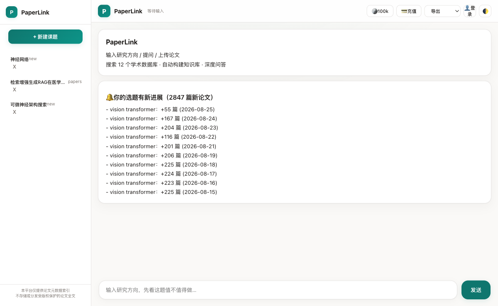

# PaperLink — AI 研究记忆伴侣

> 不是又一个搜索框，是「记住你的研究、主动告诉你该读什么」的学术助手。
> 面向中文研究者的「选题 → 初稿」全流程：选题可行性判断 → 12 源检索建库 → 证据问答 → 辅助写作。

[](https://www.python.org/)
[](https://fastapi.tiangolo.com/)
[](LICENSE)
[](https://www.docker.com/)

## 这是什么

PaperLink 是一个面向中文研究者的 **AI 学术研究伴侣**。核心差异化不是「搜索/问答」（那是 DeepSeek/Perplexity 的红海），而是：

| 红海（人人都在做）| PaperLink 的蓝海 |
|---|---|
| 用户问 → 系统答（无状态）| 系统**记住**你的选题/论文 → **主动推送**「你的方向有新进展」|
| 通用问答（大厂更强）| 真实文献锚定 + 不编造引用（学术高精度场景）|
| 全量学术库（谁都没有）| 开放图谱 + 用户私有库（合法、精准、护城河）|

**完整闭环**：输入选题（一键可行性判断）→ 研究空白报告（带摘要预览+链接）→ 搜索/上传建私有知识库 → 证据问答/辅助写作 → **自动订阅 + 每日检索新进展 + 主动推送**。

**技术底座**：自适应混合检索（BM25+向量 RRF + 两级级联重排 + 双语重排）、三层意图漏斗、自我进化三环（反思/反馈教训/技能记忆）、LLM 容错降级、学术白名单闸门 + SSRF/路径穿越防护。



*「你的选题有新进展」——主动推送（蓝海差异化）：系统记住你的选题，每日检索新论文并主动告知。*

## 快速开始

```bash
# 1. 克隆
git clone https://github.com/tyzco/ai-research-assistant.git
cd ai-research-assistant

# 2. 配置
cp .env.example .env
# 编辑 .env，填入 DEEPSEEK_API_KEY (https://platform.deepseek.com)

# 3. 启动 (三选一)
python api.py                      # 开发模式
docker-compose up -d               # Docker 生产部署
pip install -e . && paperlink      # 命令行 (即将支持)

# 4. 打开 http://localhost:8001
```

**唯一必填依赖**：DeepSeek API Key（[免费注册](https://platform.deepseek.com)）。嵌入模型首次运行自动下载。

## 分段演示（拉投资 / 项目展示 / 吸引协作）

每个产品模块独立可跑、真实调用后端、输出即演示稿，模块间状态衔接可整体串联：

```bash
python demo/run_all.py "你的研究方向"     # 一键串联 7 个模块（检索→建库→问答→Agent→团队→写作→审稿）
python demo/demo_01_search.py "研究方向"  # 单模块演示
```

模块清单、产品定位与变现指向、合法边界见 [demo/README.md](demo/README.md)。演示产物（Markdown 报告）保存到 `demo/output/`。

## 用户使用指南

打开 `http://localhost:8001` 后，**统一流程（无模式切换，系统自动带你走）**：

**第 1 步：输入研究方向**
- 底部输入框输入研究方向（如"情感分析"、"图神经网络在推荐系统中的应用"）回车
- 系统**自动做选题可行性判断**（研究空白分析）→ 逐字流式输出报告（含摘要预览 + 可点击链接）

**第 2 步：下一步动作（报告下方三个按钮）**
- 🔍 **搜索相关论文** → 建课题 + 12 源检索，论文面板**自动弹出**
- 📤 **上传 PDF 建库** → 或用学校账号下载闭源论文后拖拽上传

**第 3 步：构建知识库**
- 论文面板顶部「⬇📥 一键下载全部 OA 论文建库」→ 批量下载 + 自动建库（进度条实时显示）
- 或拖拽 PDF 到页面上传（支持多文件，自动解析分块）

**第 4 步：证据问答 / 辅助写作**
- 建库后输入问题 → 基于知识库回答（带真实引用）
- 点「辅助写初稿」→ Agent 给大纲 + 可引用文献 + 把关，**用户负责写**
- 危险操作会弹出**人工确认闸门**；执行过程有可折叠**时间线**

**第 5 步：主动推送（蓝海核心）**
- 建课题时**自动订阅**该方向 → 系统每日检索新论文 → 下次打开页面提示「🔔 你的选题有新进展」
- 这是 DeepSeek / 谷歌学术给不了的：**系统记住你的选题，主动告诉你该读什么**

> 开发者侧（调试/追踪/监控）不占用户界面：`/static/pipeline.html`（RAG 链路）、`/static/test.html`（API 面板 + 实时状态）、`/metrics`、`/agent/tools` 等均为独立开发页面/端点。

## 开发者：测试与实时监控

### 挨个模块测试

```bash
python test_e2e.py                # 端到端自动化测试 (策略→嵌入→建库→问答, 断言+清理+JSON报告)
python run_eval.py --limit 5      # 检索评估: hybrid vs vector 对比 + 回归门禁 (下降>0.02 阻断)
python benchmark.py --limit 5     # 检索延迟 p50 + token 估算 + 成本
python evaluate_rag_standards.py --limit 2   # RAGAS 生成质量指标
python reindex_all.py --dry-run   # 查看待重建表 (嵌入模型换型后: python reindex_all.py)
python -m pytest tests/ 2>/dev/null || echo "无 pytest 套件, 用上方脚本即可"
```

每个脚本支持 `--kb 表名` / `--qa 路径` / `--limit N`。评估结果存 `data/*.json` 可对比回归。

### 实时监控

| 入口 | 方式 | 内容 |
|---|---|---|
| `GET /health` | curl | 服务存活 |
| `GET /metrics` | curl | 延迟/Token/错误率/成本估算 |
| `GET /agent/pi/stats` | curl | Hook 调用次数 + 上下文压缩 + 工具错误统计 |
| `GET /agent/tools` | curl | 全部已注册工具 + 被哪些技能引用 |
| `POST /agent/tools/reload` | curl | 重扫 `tools_extra/` 插件（新增工具不重启即生效） |
| `GET /team/status?run_id=...` | curl | 科研团队执行进度 + 审批状态 |
| `/static/dev.html` | 浏览器 | **开发者中心**（实时状态 + 工具/技能 + 配额 + 开发入口聚合） |
| `/static/pipeline.html` | 浏览器 | RAG 六步检索链路实时追踪（面试演示） |
| `/static/kg.html` | 浏览器 | 知识图谱可视化（悬停透镜聚焦） |
| `/static/test.html` | 浏览器 | API 测试面板（一键测全部端点 + curl 导出 + 实时系统状态 /metrics + Agent 统计） |
| `GET /topics` | curl | 课题列表与状态 |
| `GET /quota` | curl | 当前 LLM 配额（免费/已用/剩余） |
| `POST /quota/topup` | curl | 充值占位（Stripe webhook 回调调用） |
| `POST /quota/checkout` | curl | 创建 Stripe 支付会话 → 跳转托管支付页 |
| `POST /stripe/webhook` | curl | Stripe webhook：支付成功自动充值配额（需 `STRIPE_WEBHOOK_SECRET`） |

**快速健康检查**：
```bash
curl -s localhost:8001/health && echo
curl -s localhost:8001/metrics | python -m json.tool
```

### 产品化设计要点

- **Agent 单一入口**：前端统一走 `/agent/pi`（hook 驱动 + 技能 + 工具链 + 人工确认门），`/team/start` 多 agent 团队显式选择
- **可观测**：每请求 request_id 贯穿日志；trace.steps 逐轮工具调用；`/agent/pi/stats` 汇总
- **安全**：工具参数校验 + 域名白名单 + 危险工具人工确认门；`TOOL_SECURITY_BLOCK_NON_WHITELIST` 可升级严格模式
- **多用户**：登录后课题归你名下（user_id 落库）；`/topics` 列表过滤 + `/ask` `/topic_status` `/upload_pdf` `/download_bulk` `/topic` 单课题 **ownership 校验**（他人课题 403）；历史匿名课题仍共享可见；run_id 注册表隔离（`/team/*` 与 `/agent/pi/approve`）
- **推理模型适配**：DeepSeek 生成已禁用链式推理（`thinking: disabled`），防复杂 prompt 下输出空串

## 核心能力

### 1. 全链路文献调研与综述合成

```
研究方向 → 选题评估 → 12源并行检索 → 质量筛选 → 知识库构建 → 综述生成
                          ↑ 人工审批闸门 1: 选题方向确认
                          ↑ 人工审批闸门 2: 核心文献入选
```

- 覆盖 arXiv, OpenAlex, Semantic Scholar, Crossref, CORE, DOAJ, PubMed, Europe PMC, PapersWithCode, CNKI 等 12 个学术源
- 自适应混合检索：4 特征动态 BM25/向量权重，非固定 50:50
- 级联重排：MiniLM 预筛 → bge-reranker 精排
- 支持中英文学术术语自动翻译和双语检索

### 2. 论文全流程写作辅助

```
综述内容 → 引言章节 → 方法章节 → 实验章节 → 图表说明 → 参考文献管理
```

- 6 个中游产出 Agent 分工协作：综述合成 / 引言 / 方法 / 实验 / 图表 / 参考文献
- 每个论点自动引用已入库论文
- 输出格式：学术 Markdown + BibTeX / GB/T 7714 / APA

### 3. 学术深度问答与知识管理

- 基于全文的 RAG 问答（自适应混合检索 + 三层 Prompt）
- 多轮指代消解 + 对话记忆持久化
- 知识图谱可视化（论文-实体关系网络）
- 课题管理（多课题隔离、SQLite 持久化）

### 4. 数据驱动的科研决策支持

- 引用计数加权排序（Semantic Scholar + OpenAlex 提供）
- 模拟同行审稿：从技术正确性/实验说服力/贡献清晰度/写作质量 4 维评分
- 伦理合规审查 + 格式规范校验

```
初稿 → 同行审稿 → 格式校验 → 伦理审查 → 终稿定稿
                              ↑ 人工审批闸门 3: 最终结论定稿
```

## 架构

```
research_team.py    ← 13 Agent 虚拟科研团队 (上游3+中游6+下游4)
pi_agent.py         ← Hook 驱动单 Agent 循环 (10 个干预节点)
hooks.py            ← 生命周期钩子系统 (trace→turn→model→tool→emit)
context_engine.py   ← 上下文工程 (token 阈值压缩 + 工具输出截断)
tool_manager.py     ← 工具调用管理 (参数校验 + 安全检查 + 错误恢复)
skills.py           ← 七大能力技能系统 (检索/写作/问答/决策/引用链/批判/实验)
tool_registry.py    ← 14 工具注册表 (OpenAI Function Calling + tools_extra 插件动态加载)
intent_classifier.py← 三层漏斗第 2 层: 嵌入语义意图分类 (规则快路径 → 语义兜底 → LLM 工具层)
eval_common.py      ← 评估脚本共享工具 (数据加载/选表/语义召回/MRR)
```

**RAG 链路**：
```
query → 指代消解 → 查询改写(语义校验) → 自适应混合检索(BM25+向量RRF) 
     → 级联重排(MiniLM→bge-reranker) → 父子分块扩展 → 三层Prompt → DeepSeek生成
```

## 项目结构

```
├── api.py                   # FastAPI 后端 (42 端点)
├── search.py                # 12 源并行搜索 + 检索策略生成
├── qa_engine.py             # RAG 问答核心 (8 步链路)
├── draft_quality.py         # 初稿质量清单 (选题→初稿验收线: 6 项自检, Agent 工具)
├── research_gap.py          # 研究空白分析 (有没有人做过 → 空白/可行性报告)
├── feedback_lessons.py      # 反馈驱动调整 (P2): 低分反馈 → 易失败教训注入 Agent
├── agent_skills.py          # 持久技能记忆 (P3): 成功任务做法跨会话复用
├── quota.py                 # 按量付费配额 (免费额度→用量追踪→充值占位)
├── draft_review.py          # 初稿审稿与批注 (模拟同行评审: 5 维评分+逐条批注)
├── hybrid_retriever.py      # 自适应混合检索 + 级联重排
├── knowledge_base.py        # LanceDB 双层索引 + FTS
├── database.py              # SQLite 持久化 (5 表, WAL 模式)
├── embedder.py              # 嵌入模型抽象层 (bge-m3 热切换)
├── config.py                # 集中配置中心 (所有参数)
├── downloader.py            # PDF 解析 + 图片提取 + 语义分块
├── conversation_memory.py   # 多轮对话记忆 (SQLite)
├── intent_classifier.py     # 三层漏斗第 2 层: 嵌入语义意图分类 (margin 相对置信度)
├── agent/
│   ├── research_team.py     # ★ 13 Agent 虚拟科研团队 + 双轨审批
│   ├── pi_agent.py          # Hook 驱动单 Agent (默认前端入口)
│   ├── hooks.py             # 10 个生命周期干预节点
│   ├── context_engine.py    # 上下文压缩 + 工具输出管理
│   ├── tool_manager.py      # 参数校验 + 安全 + 错误恢复
│   ├── skills.py            # 七大技能系统
│   ├── tool_registry.py     # 工具注册表 (插件动态加载)
│   └── tools_extra/         # 工具插件目录 (丢文件即注册, 如 academic.py)
├── static/
│   ├── index.html           # 主界面 (SPA, ~44KB 零构建, agent 默认)
│   ├── kg.html              # 知识图谱 (Obsidian 风格 D3 force-graph)
│   ├── pipeline.html        # RAG 流水线实时追踪 (面试演示)
│   └── test.html            # API 测试面板
├── eval_common.py           # 评估共享工具 (load_eval_qa/pick_kb/semantic_recall/mrr)
├── run_eval.py              # 检索评估: hybrid vs vector + 回归门禁
├── run_benchmark.py         # 多主题真实基准 (30题/5主题 + 环境/局限文档)
├── benchmark.py             # 检索延迟 + token 估算 + 成本
├── evaluate_rag_standards.py# RAGAS 生成质量指标 (faithfulness/context_precision...)
├── test_e2e.py              # 端到端自动化测试 (断言/清理/JSON 报告)
├── reindex_all.py           # 向量重建工具 (原子双表替换)
├── demo/                    # 分段产品演示 (7 模块脚本驱动, 可串联, 见 demo/README.md)
├── Dockerfile               # 多阶段构建 (非 root 用户)
├── docker-compose.yml       # 一键部署
└── data/                    # 运行时数据 (SQLite + LanceDB)
```

## 技术栈

| 层 | 技术 | 理由 |
|---|---|---|
| API | FastAPI + SSE | 异步原生，流式响应 |
| 向量库 | LanceDB (嵌入式) | 零运维，支持 BM25 FTS |
| 嵌入 | bge-small-zh (512d) / bge-m3 (1024d) | MTEB 中文 top，支持热切换 |
| 重排 | MiniLM + bge-reranker | 两阶段工业标准 |
| LLM | DeepSeek | 高性价比 |
| PDF | PyMuPDF | 比 PyPDF2 快 10x |
| 分块 | LangChain RecursiveCharacterTextSplitter | 社区标准 |
| Agent | 自研 Hook 驱动循环 + OpenAI Function Calling | 10 个生命周期节点 + 工具注册表 |
| 存储 | SQLite (WAL) | 零配置，并发安全 |
| 前端 | 纯 HTML/CSS/JS (零构建) | 面试演示无需 npm install |
| 图谱 | D3.js force-graph | 零依赖前端可视化 |

## 评估指标

| 指标 | 数值 (bge-small-zh 512d) | 说明 |
|---|---|---|
| Recall@5 | 0.7703 | top-5 与 ground truth 最大余弦相似度 |
| Hybrid vs Vector | 0.7704 vs 0.7703 | BM25 贡献 (中文分词限制) |
| MRR | 0.75 | Mean Reciprocal Rank |
| Faithfulness | 0.8227 | LLM-as-judge 忠实度 |

**bge-m3 升级**: 模型已就绪，GPU 重建向量后预期 Recall@5 提升至 0.80-0.85。

## 设计原则

1. **不替代研究者判断**：核心决策节点（选题方向/文献入选/最终结论）设人工审批闸门
2. **Agent 自动执行 + 人工审批双轨**：Auto track 自动化机械工作，Human track 守护学术质量
3. **全链路可追溯**：每一步 Agent 产出带来源引用，全程可审计可干预
4. **零幻觉兜底**：文献综述每个论点强制引用 [论文: 标题, 年份] 格式，无引用不输出

## 竞品定位

PaperLink 在 GitHub 上的差异化优势（详见 [竞品全景分析](docs/COMPETITIVE_ANALYSIS.md)、[自我进化系统](docs/SELF_EVOLUTION.md) 与 [交付总结](docs/DELIVERY.md) 与 [宣传数据事实清单](docs/PITCH_FACTS.md)）：

- **12 学术源并行** — 同类最多（OpenDraft 4源, ScholarFlow 5源, arxiv-tracker 仅 arXiv）
- **15 Agent + 三层双轨审批** — 唯一结合"上游调研→中游产出→下游智控"三层架构 + 引用精度验证的项目
- **零外部依赖部署** — Docker + SQLite + LanceDB, 不需要 GPU
- **全链路覆盖** — 选题→检索→筛选→综述→写作→审稿→校验→伦理→定稿→导出
- **多格式论文导出** — Markdown / DOCX / LaTeX / BibTeX 一键导出
- **生态衔接** — Zotero Bridge / Citation Chain / 研究方向订阅

## 开源协议

MIT License — 详见 [LICENSE](./LICENSE)

## 贡献

欢迎提交 Issue 和 PR。主要贡献方向：
- 嵌入模型升级与评测
- 新学术数据源接入
- Agent 工作流优化
- 前端交互改进

## 致谢

- [pi-agent](https://github.com/earendil-works/pi) — Agent 循环设计参考
- [PaperQA2](https://github.com/Future-House/paper-qa) — RAG 精度基准
- [Research Radar](https://github.com/GZ-November/research-radar) — 信任闸门设计参考
- [OpenDraft](https://github.com/federicodeponte/opendraft) — 论文格式导出参考
- [LanceDB](https://lancedb.com/) — 嵌入式向量数据库
- [BAAI/bge](https://huggingface.co/BAAI) — 中文嵌入模型
- [DeepSeek](https://platform.deepseek.com) — LLM API
