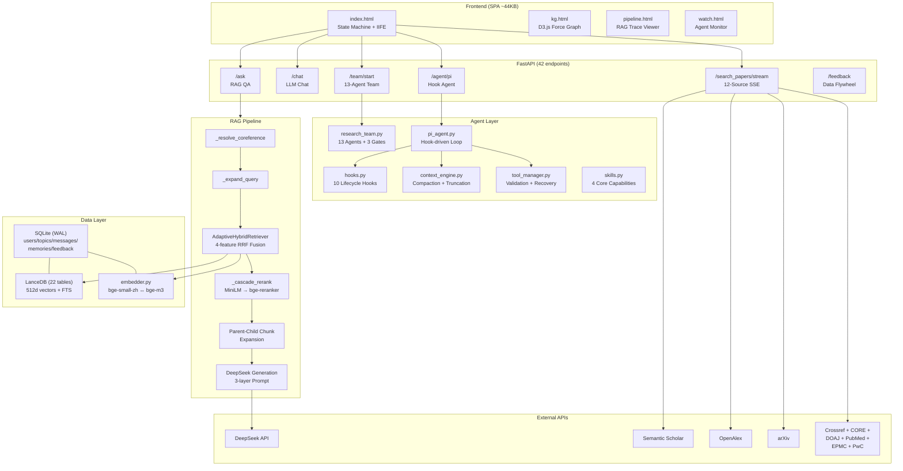

# PaperLink v4.0 — 系统架构文档

## 架构全景图



## 请求生命周期

### RAG 问答 (`/ask`, ~3-5s)

```
1. sanitize_input(question)           # monitor.py: 去控制字符 + 注入检测
2. _resolve_kb_table(topic_id)        # memory→SQLite→404
3. ask_question(table, q, memory_key=topic_id)
   3.1 _resolve_coreference(q, history)   # LLM: "它的缺点"→"RAG的缺点"
   3.2 _expand_query(q)                    # LLM: 改写为检索友好形式
   3.3 _validate_expansion(q, expanded)     # bge: cosine ≥ 0.75
   3.4 AdaptiveHybridRetriever.search()
       3.4.1 _compute_adaptive_weight(q)    # 4特征: 长度/缩写/问句/长度
       3.4.2 _vector_recall(q, top_k*4)     # bge-small-zh 512d
       3.4.3 _bm25_recall(q, top_k*4)       # LanceDB FTS
       3.4.4 _adaptive_rrf(vec, bm25, alpha)# 加权RRF融合
       3.4.5 _cascade_rerank(40→15→5)      # MiniLM → bge-reranker
   3.5 父子分块扩展                         # chunk_index ± 1 neighbors
   3.6 QA_PROMPT 三段式构建                 # 全文+图片+摘要
   3.7 DeepSeek 生成                        # safe_call(max_retries=2)
   3.8 get_memory(id).add_turn(q, a)         # SQLite 持久化
4. get_db().add_message(topic_id, user/assistant)  # SQLite 消息记录
5. return AskResponse(answer, references, supplement, images)
```

### 科研团队流程 (`/team/start`, 30-120s+)

```
1. User task → ResearchTeam.execute(task)
2. FOR EACH agent IN PIPELINE:
   ├── 跳过可选 agent (已有KB可跳过检索)
   ├── _run_agent(agent_key, agent_def)
   │   ├── 构建 system prompt (agent专属角色+可用工具+上游上下文)
   │   ├── DeepSeek 调用 (带 tools schema)
   │   └── 返回 agent 输出
   ├── state[agent_key] = output
   └── IF needs_approval:
       └── RETURN {status: "awaiting_approval", gate, request}
3. 等待人工审批 → POST /team/approve → approve_and_continue()
4. 继续执行直到下一个 gate 或全部完成
```

### Pi-Agent 循环 (`/agent/pi`, 动态步数)

```
FOR turn IN range(max_steps):
  ├── HOOK: turn_start (max_steps guard, 超时检查)
  ├── 上下文压缩检查 (should_compact → compact_history)
  ├── HOOK: before_model (tool allowlisting, context transform)
  ├── LLM 调用 (tools + messages)
  ├── HOOK: after_model (tool_call audit, 危险工具过滤)
  ├── IF tool_calls:
  │   ├── 参数校验 + 类型转换 (tool_manager.validate_params)
  │   ├── HOOK: before_tool (安全检查)
  │   ├── 工具执行 (max 3 retries with backoff)
  │   ├── 输出截断 (truncate_tool_output → file)
  │   ├── HOOK: after_tool
  │   └── 结果 → messages (tool role)
  └── ELSE (无工具调用 → 直接回答):
      ├── HOOK: before_emit (sensitive filter)
      ├── answer → messages (assistant role)
      └── break (final answer)
```

## 13-Agent 科研团队架构

```
┌─────────────────────────────────────────────────────────────────┐
│                      RESEARCH PIPELINE                          │
│                                                                 │
│  UPSTREAM (调研层)                                              │
│  ┌──────────────┐  ┌──────────────────┐  ┌───────────────────┐ │
│  │ 选题评估      │→│ 多元文献检索       │→│ 文献质量筛选        │ │
│  │ topic_       │  │ multi_source_    │  │ quality_          │ │
│  │ evaluator    │  │ searcher         │  │ screener          │ │
│  └──────┬───────┘  └──────────────────┘  └────────┬──────────┘ │
│         │ 🔴 Gate 1: 选题方向确认         🔴 Gate 2: 文献入选  │
│         │                                          │            │
│  MIDSTREAM (产出层)                              │             │
│  ┌──────▼───────┐  ┌──────────────────┐  ┌───────▼──────────┐ │
│  │ 文献综述合成  │  │ 引言章节写作       │  │ 方法章节写作      │ │
│  │ review_      │  │ chapter_writer_  │  │ chapter_writer_  │ │
│  │ synthesizer  │  │ intro            │  │ method           │ │
│  └──────────────┘  └──────────────────┘  └──────────────────┘ │
│  ┌──────────────┐  ┌──────────────────┐  ┌──────────────────┐ │
│  │ 实验章节写作  │  │ 图表说明生成       │  │ 参考文献管理      │ │
│  │ chapter_     │  │ figure_          │  │ bib_manager      │ │
│  │ writer_exp   │  │ generator        │  │                  │ │
│  └──────────────┘  └──────────────────┘  └──────────────────┘ │
│                                                                 │
│  DOWNSTREAM (智控层)                                           │
│  ┌──────────────┐  ┌──────────────────┐  ┌───────────────────┐ │
│  │ 模拟同行审稿  │→│ 格式规范校验       │→│ 伦理合规审查        │ │
│  │ peer_        │  │ format_checker   │  │ ethics_reviewer   │ │
│  │ reviewer     │  │                  │  │                   │ │
│  └──────┬───────┘  └──────────────────┘  └────────┬──────────┘ │
│         │                                         │            │
│  ┌──────▼─────────────────────────────────────────▼──────────┐ │
│  │ 终稿定稿 (final_drafter)                                    │ │
│  │ 🔴 Gate 3: 最终结论定稿                                      │ │
│  └────────────────────────────────────────────────────────────┘ │
└─────────────────────────────────────────────────────────────────┘
```

## 数据库 Schema

### SQLite (WAL mode)

```sql
users       (username, password, email, created_at)
topics      (topic_id, query, status, lancedb_table, total_papers,
             uploaded_papers, total_images, search_strategy, step,
             current, dl_total, user_id, created_at, updated_at)
messages    (id, topic_id FK, role, content, created_at)
memories    (topic_id FK, recent, summary, core, updated_at)
feedback    (id, question, answer, rating, comment, created_at)
```

### LanceDB (per knowledge base, 13 fields)

```
chunk_id STRING | paper_id STRING | title STRING | authors STRING
year INT32 | abstract STRING | doi STRING
is_fulltext BOOL | is_image BOOL | image_path STRING
page_number INT32 | chunk_index INT32
text STRING | vector FLOAT32[DIM]
```

## Hook 干预节点

```
trace_start     → 任务开始，注入系统消息
  turn_start    → 轮次开始，步数/超时检查
    before_model→ LLM 调用前，修改 messages/tools
    after_model → LLM 返回后，审计 tool_calls
    before_tool → 工具执行前，参数校验+安全检查
    after_tool  → 工具执行后，输出截断+写入文件
  turn_end      → 轮次结束，token 统计
  before_emit   → 结果输出前，敏感词检测
  after_emit    → 结果输出后，审计日志写入
trace_end       → 任务结束，统计汇总
```
